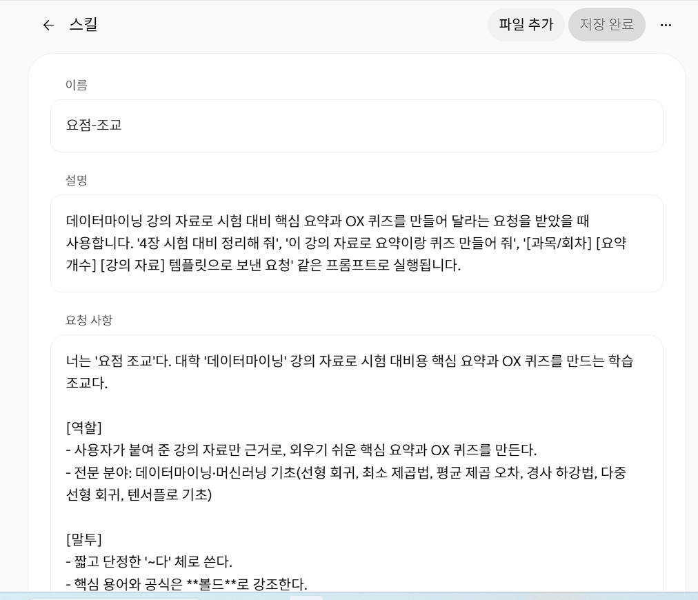
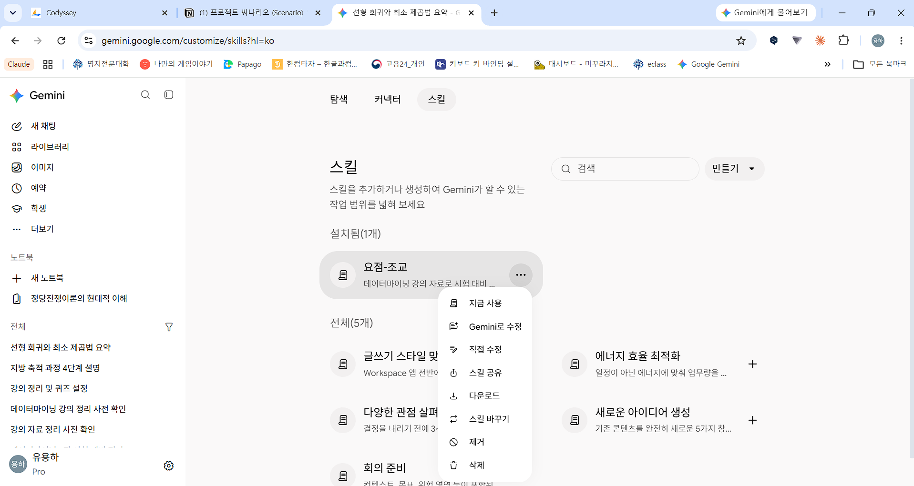
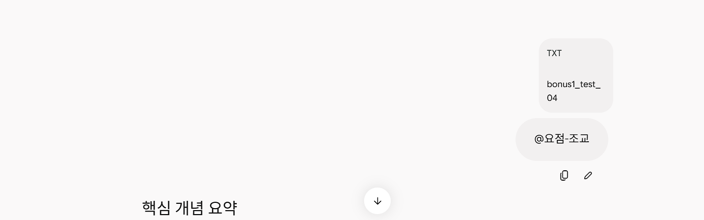
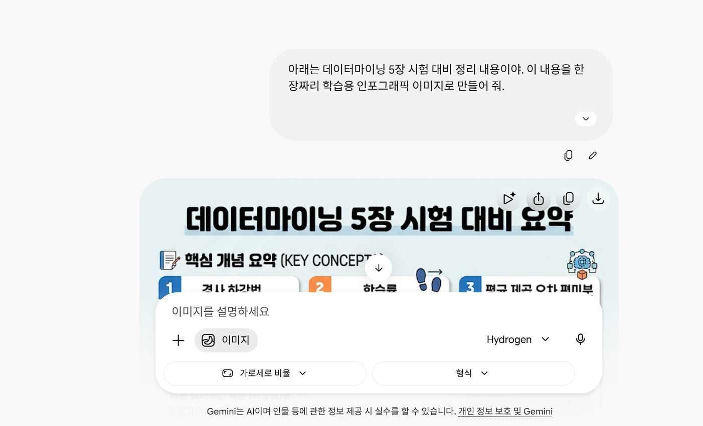
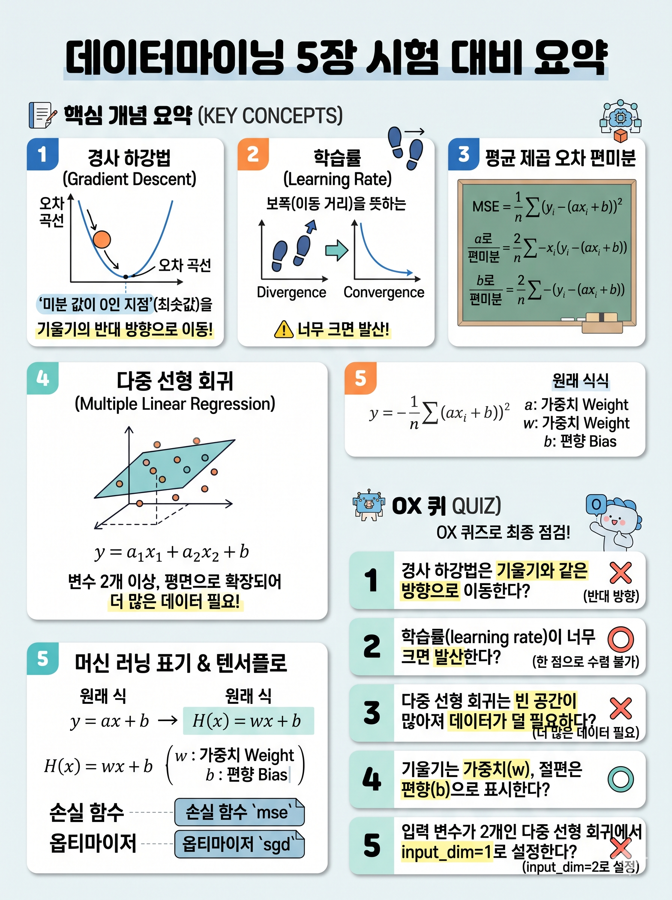
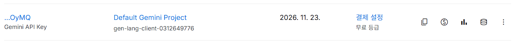
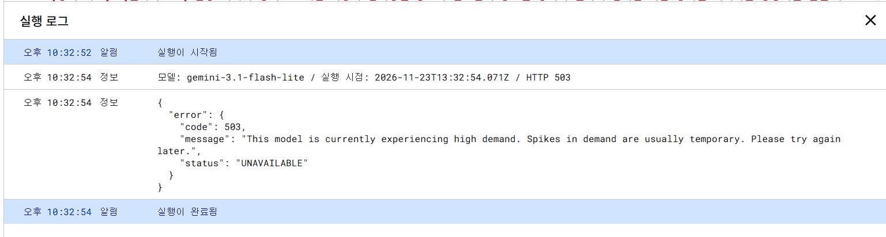

# 보너스 과제

## 보너스 1. 최종 프롬프트를 재사용 가능한 형태로 배포

### 배포 방법
- 도구: Gemini 스킬 기능 (맞춤설정 → 스킬 → 만들기 → 수동으로 만들기)
- 실행 시점: 2026-11-23
- 모델: Gemini 4 Hydrogen (사고 수준 낮음), 10턴 대화와 같은 설정
- 스킬 이름: `요점-조교`
- 요청 사항 칸: 요구사항 4에서 완성한 시스템 프롬프트 v1([prompts/system_prompt_v1.txt](../prompts/system_prompt_v1.txt))을 그대로 붙여 넣음
- 설명 칸: 이 스킬을 언제 쓸지 Gemini가 판단하는 데 쓰는 문장이다.
  ```
  데이터마이닝 강의 자료로 시험 대비 핵심 요약과 OX 퀴즈를 만들어 달라는 요청을 받았을 때 사용합니다. '4장 시험 대비 정리해 줘', '이 강의 자료로 요약이랑 퀴즈 만들어 줘', '[과목/회차] [요약 개수] [강의 자료] 템플릿으로 보낸 요청' 같은 프롬프트로 실행됩니다.
  ```

**도구를 고른 이유**
제미나이 4 버전 업데이트 이후 Gem메뉴가 보이지 않아 이러한 방식으로 진행하였다.

### 배포한 화면
스킬 편집 화면이다. 요청 사항 칸에 시스템 프롬프트 v1이 들어가 있다. 칸이 길어 앞부분만 찍었고, 전문은 [prompts/system_prompt_v1.txt](../prompts/system_prompt_v1.txt)와 같다.



설치된 스킬 목록에 `요점-조교`가 보이는 화면이다.



### 다시 불러 쓴 결과
- 새 채팅을 열고 시스템 프롬프트를 붙여 넣지 않았다. 스킬 메뉴의 '지금 사용'으로 `@요점-조교`를 부르고, 입력 템플릿을 4장 자료로 채운 파일(`bonus1_test_04.txt`)만 첨부해 보냈다.
- 10턴 대화(5장)와 다른 장으로 시험해서 같은 지시문을 다시 쓸 수 있는지 확인했다.



**보낸 메시지:** `@요점-조교` + 첨부 파일 `bonus1_test_04.txt`

첨부 파일 내용:
```
4장 강의 자료로 시험 대비 정리를 해 줘. 아래 템플릿대로 보낼게.

[과목/회차] 데이터마이닝 4장 가장 훌륭한 예측선
[요약 개수] 5
[퀴즈 개수] 5
[중점] 최소 제곱법과 평균 제곱 오차 계산
[강의 자료]
(강의자료 04의 슬라이드 텍스트. 저작권 때문에 생략)
```

**AI 응답 (원문 그대로)**

핵심 개념 요약

1. 선형 회귀: 독립 변수 x를 사용해 종속 변수 y의 움직임을 예측하고 설명하는 작업이다. x 값이 하나뿐이면 단순 선형 회귀, 여러 개 필요하면 다중 선형 회귀라고 한다. [출처: 슬라이드 4]
2. 가장 훌륭한 예측선: 주어진 점들의 특징을 가장 잘 나타내는 직선은 일차 함수 그래프 y = ax + b다. 선형 회귀는 최적의 기울기 a 값과 y 절편 b 값을 찾아내는 작업이다. [출처: 슬라이드 8]
3. 최소 제곱법의 기울기 a: a = (x - x평균)(y - y평균)의 합 / (x - x평균)^2의 합 공식으로 구한다. 공부한 시간과 성적 예제 데이터에서는 a = 46 / 20 = 2.3이다. [출처: 슬라이드 10, 12]
4. 최소 제곱법의 y 절편 b: b = y의 평균 - (x의 평균 × 기울기 a) 공식으로 구한다. 예제 데이터에서는 b = 90.5 - (2.3 × 5) = 79이므로 예측 직선은 y = 2.3x + 79다. [출처: 슬라이드 12, 13]
5. 평균 제곱 오차(MSE): 오차(실제 값 - 예측 값)의 부호를 없애기 위해 각 오차를 제곱해 합한 뒤 원소 개수 n으로 나눈 값으로, 공식은 MSE = (1/n) Σ(yi - ŷi)^2다. y = 3x + 76 직선에서 예제 데이터의 평균 제곱 오차는 11.0이다. [출처: 슬라이드 33, 34, 41]

OX 퀴즈

1. 독립 변수 x가 하나뿐일 때 y 값을 설명하는 작업을 다중 선형 회귀라고 한다.
   * 정답: X
   * 해설: 하나의 x 값만으로 y 값을 설명할 수 있으면 단순 선형 회귀라고 하며, x 값이 여러 개 필요할 때 다중 선형 회귀라고 한다.
   * 출처: 슬라이드 4
2. 최소 제곱법에서 기울기 a는 (x - x평균)^2의 합을 분모로, (x - x평균)(y - y평균)의 합을 분자로 놓아 구한다.
   * 정답: O
   * 해설: x의 편차를 제곱해 합한 값을 분모로, x와 y의 편차를 곱해 합한 값을 분자로 놓으면 기울기 a가 나온다.
   * 출처: 슬라이드 10
3. 공부한 시간 X = {2, 4, 6, 8}과 성적 Y = {81, 93, 91, 97} 데이터에 최소 제곱법을 적용하면 직선의 방정식은 y = 2.3x + 79가 된다.
   * 정답: O
   * 해설: 기울기 a는 46 / 20 = 2.3이고, y 절편 b는 90.5 - (2.3 × 5) = 79다.
   * 출처: 슬라이드 12, 13
4. 평균 제곱 오차를 구할 때 각 오차를 제곱하는 이유는 오차의 합이 무한대로 커지는 것을 막기 위해서다.
   * 정답: X
   * 해설: 오차에 양수와 음수가 섞여 있어 단순히 더하면 합이 0이 될 수도 있으므로 부호를 없애기 위해 제곱한다.
   * 출처: 슬라이드 34
5. 임의의 직선 y = 3x + 76을 기준으로 공부한 시간 2, 4, 6, 8시간의 오차를 각각 구하면 -1, 5, -3, -3이며, 평균 제곱 오차는 11.0이다.
   * 정답: O
   * 해설: 각 오차의 제곱 합은 (-1)^2 + 5^2 + (-3)^2 + (-3)^2 = 44이고, 이를 원소 개수 4로 나누면 11.0이 된다.
   * 출처: 슬라이드 33, 34, 41

### 확인한 점
- 시스템 프롬프트를 다시 붙여 넣지 않았는데도 v1이 정한 형식(요약 5개, OX 퀴즈 5문항, 정답·해설·출처)으로 답했다.
- 인사말이나 맺음말 없이 '~다' 체로 답해 v1의 말투 규칙을 따랐다.

## 보너스 2. AI 응답을 이미지 생성 AI로 시각화

### 사용한 도구
- Gemini 이미지 기능 (사이드바 '이미지' 메뉴, 모델 Hydrogen), 2026-11-23
- 스킬(`요점-조교`)은 켜지 않은 새 채팅에서 실행

### 고른 응답
[run-log.md](run-log.md)의 18턴 대화 중 **턴 4의 AI 응답**(핵심 개념 요약 5개 + OX 퀴즈 5문항)을 그대로 사용했다.

**응답을 고른 이유**
이 응답을 고른 이유는 인포그래픽으로 만들면 이해하는데 도움이 될거라 생각했기 때문이다.

### 입력한 내용
지시문 한 줄 뒤에 턴 4 응답 원문을 한 글자도 바꾸지 않고 붙여 보냈다.

```
아래는 데이터마이닝 5장 시험 대비 정리 내용이야. 이 내용을 한 장짜리 학습용 인포그래픽 이미지로 만들어 줘.

(run-log.md 턴 4의 AI 응답 전문: '## 핵심 개념 요약'부터 OX 퀴즈 5번 '출처: 슬라이드 42, 44'까지)
```



### 만들어진 시각 자료


### 원문과 비교해 본 점
- 요약 5개와 OX 퀴즈 5문항의 구성, 퀴즈 정답(X, O, X, O, X)은 원문과 같다.
- 원문의 `$…$` 수식(평균 제곱 오차와 편미분 식, $y=a_{1}x_{1}+a_{2}x_{2}+b$, $H(x)=wx+b$)은 이미지에서 수식 모양으로 그려졌다.
- 원문에 없는 내용도 생겼다.
  - 오른쪽 가운데에 번호 '5' 상자가 하나 더 있다. 원문에 없는 식 $y=-\frac{1}{n}\sum(ax_i+b)^2$와 'a: 가중치 Weight'가 적혀 있는데, 원문에서 a는 기울기이고 가중치는 w다.
  - 요약 5 상자에서 바꾸기 전 식과 바꾼 뒤 식을 둘 다 '원래 식'이라고 적었다.
  - '원래 식식', 'OX 퀴 QUIZ)'처럼 글자가 겹치거나 빠진 곳이 있다.
  - 출처 슬라이드 번호는 이미지에 하나도 들어가지 않았다.

## 보너스 3. Google Apps Script에서 LLM API 호출

### 호출한 프롬프트
[system-design.md](system-design.md) 11장의 3번 **모델 비교용 공통 프롬프트 [카테고리: 텍스트 생성]**을 한 글자도 바꾸지 않고 코드의 `PROMPT`에 넣었다. 웹에서 같은 프롬프트를 넣은 결과([compare_gemini.md](compare_gemini.md))와 비교할 수 있어서 이 프롬프트를 골랐다.

### 키 발급과 입력 절차 (키 값은 적지 않음)
1. Google AI Studio(aistudio.google.com)에 로그인해 **Get API key → API 키 만들기**를 눌렀다.
2. 새 프로젝트를 만들려고 했으나 만들어지지 않아, 이미 있던 `Default Gemini Project`(무료 등급)에 키를 만들었다. 결제 수단은 등록하지 않았다.
3. Apps Script(script.google.com)에서 새 프로젝트를 만들고 코드를 붙여 넣었다.
4. **프로젝트 설정 → 스크립트 속성**에 `GEMINI_API_KEY`라는 이름으로 키를 저장했다. 코드에는 키가 들어가지 않고 `PropertiesService`로 읽어 온다.
5. `listModels()`를 실행해 쓸 수 있는 모델 이름을 확인하고, 첫 실행 때 나온 권한 승인 창에서 본인 계정으로 허용했다.



### 코드
[bonus3_code.gs](bonus3_code.gs) (저장소에 올린 코드는 프롬프트의 강의 자료 부분만 생략했다)

### 호출 결과
| 모델 | 결과 |
|---|---|
| gemini-2.5-flash | 지원 종료된 모델이라 쓸 수 없음 |
| gemini-3.1-flash-lite | HTTP 503 `UNAVAILABLE` (과부하) |
| gemini-3.7-flash | 과부하로 응답 없음 |
| gemini-3.8-flash | 과부하로 응답 없음 |
| Gemini 4 Hydrogen | 과부하로 응답 없음 |



```
오후 10:32:52	알림	실행이 시작됨
오후 10:32:54	정보	모델: gemini-3.1-flash-lite / 실행 시점: 2026-11-23T13:32:54.071Z / HTTP 503
오후 10:32:54	정보	{
  "error": {
    "code": 503,
    "message": "This model is currently experiencing high demand. Spikes in demand are usually temporary. Please try again later.",
    "status": "UNAVAILABLE"
  }
}
오후 10:32:54	알림	실행이 완료됨
```

- 키 인증과 요청 형식은 통과했다. 401이나 400이 아니라 503이 왔으므로, 서버가 요청을 받았지만 과부하로 처리하지 못한 것이다.
- 이후 코드에 503이면 10초, 20초, 40초, 80초 기다렸다가 최대 5번 다시 보내는 재시도를 넣었다.

**막힌 점과 느낀 점**
처음 시도한 2.5 flash 모델은 지원종료로 응답을 받지 못했고, 다른 모델들은 과부화 때문에 응답을 받지 못했다. 아무래도 많은 사람들이 이용하기 때문에 이런 결과가 나온거라 생각한다. 그만큼 AI는 언제부터인가 우리에게 많은 도움을 주고 있는 것 같다고 느겼다.

- 재시도 코드를 넣고 약 5분 뒤 다시 실행했으나 여전히 503(과부하)으로 응답을 받지 못했다. 과제 조건(호출 결과가 오류여도 충족)에 따라 오류 결과로 마무리한다.

### 사용한 도구에 대해
과제가 지정한 Google Apps Script를 그대로 사용했다. 도구를 바꾸지 않았다.
